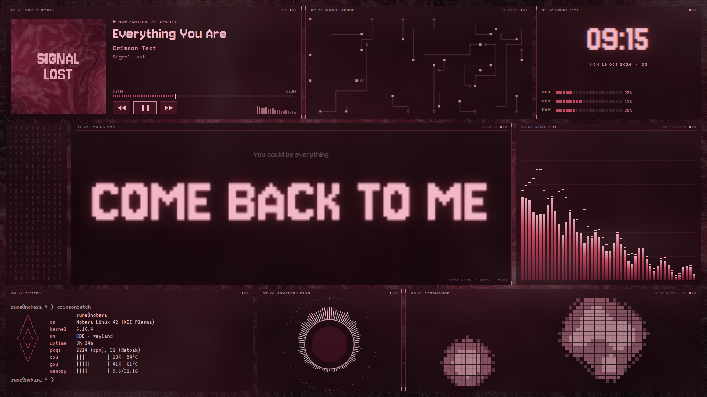
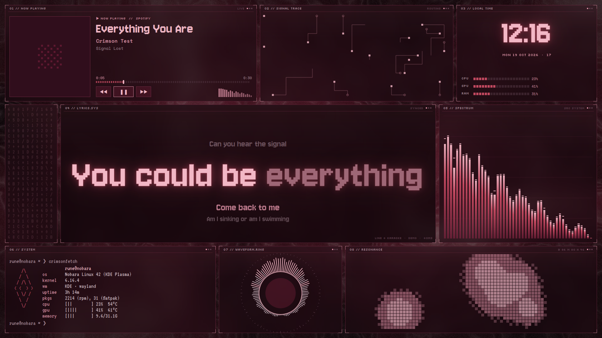
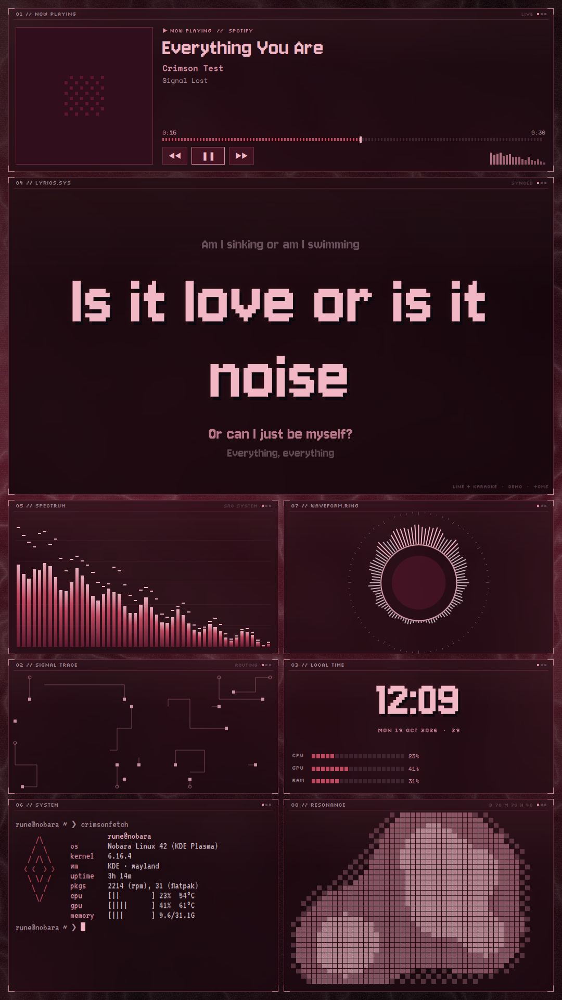
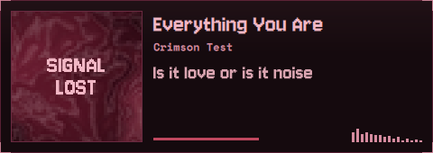

# Crimson Desktop

A crimson / dusty-pink cyberpunk music desktop for **Nobara Linux · KDE Plasma · Wayland**, built from
the reference video: a tiled dashboard with huge pixel-font lyrics synced to **Spotify**, a real
audio spectrum, a circular visualizer, live system stats and generative decorations. It also includes
a matching Kitty theme, a terminal lyrics view, and a coherent KDE color scheme and wallpaper set.



| line mode + karaoke | portrait monitor | minimal profile |
|---|---|---|
|  |  |  |

*Screenshots are rendered from the dashboard's `--demo` mode (synthetic track and spectrum). On your
machine every value is live.*

---

## Install (3 steps)

```bash
mkdir -p ~/Projects && tar -xzf crimson-desktop.tar.gz -C ~/Projects
cd ~/Projects/crimson-desktop

scripts/install.sh       # inspects the system, asks before any `sudo dnf install`, user-level setup
crimsonctl doctor        # verify
scripts/apply-theme.sh   # full desktop theme (makes a timestamped backup first)
```

* `install.sh` uses only the standard Fedora/Nobara repositories. It does not add COPR repos or
  third-party sources, and it never runs `curl | bash`. It prints the exact `dnf` command and waits
  for your **yes**.
* `apply-theme.sh` analyses `~/Downloads/home/jan/Downloads/pack 1/`, picks wallpapers for each
  monitor and writes graded copies to `wallpapers/generated/`. Your originals are only read.
  Review the ranking in `wallpapers/generated/candidates.jpg`, or override it with
  `--left FILE --right FILE`.
* Undo everything theme-related: `scripts/restore-theme.sh` (see [docs/ROLLBACK.md](docs/ROLLBACK.md)).

## Daily use

| | |
|---|---|
| `crimsonctl toggle` / `show` / `hide` | hide the dashboard instantly (no restart) — **Meta+Alt+D** |
| `crimsonctl profile crimson\|minimal\|performance\|next` | switch profile — **Meta+Alt+P** |
| `crimsonctl perf low\|balanced\|high` | animation level (default **balanced**) |
| `crimsonctl offset +100` / `-100` / `reset` | lyric timing for the current track — **Meta+Alt+] / [** |
| `crimson-lyrics` | lyrics in the terminal — **Meta+Alt+L**, or Ctrl+Shift+L inside Kitty |
| `crimsonctl status` · `doctor` · `logs -f` · `monitors` | diagnostics |
| `crimsonctl start` / `stop` / `restart` | services |
| `crimson-cava`, `crimsonfetch` | themed CAVA and fastfetch |

**On the dashboard:** click the album art to raise Spotify. Click the progress bar to seek. Scroll on
the lyrics to nudge timing by ±50 ms (saved per track). Click the lyrics to switch between word and
line mode. Middle-click resets the offset. Everything else on the dashboard passes clicks through to
the desktop.

**Profiles** (switch at any time, nothing is reinstalled):

| | |
|---|---|
| **A · Crimson Music** | the full dashboard on the right monitor |
| **B · Minimal Dark** | a small music card (art, track, current lyric line, mini spectrum) in the corner |
| **C · Performance** | dashboard off, opaque Kitty, KDE animations off, KWin blur off. Your previous values are saved and restored when you switch back |

If Feral **GameMode** is active (Nobara uses it for games), the dashboard drops to the *low* level
automatically (configurable: `low`, `hide` or `ignore`). It also does this under heavy CPU load.

## Crimson Spotify (Spicetify theme)

Spotify itself can wear the Crimson look and join the same backend. The integration adds a
custom theme, a "Crimson" sidebar page with the shared synced lyrics and the real spectrum, and
Spicetify's built-in Full App Display. It is optional and fully reversible.

```bash
crimsonctl spotify inspect   # read-only check of your Spotify / Spicetify setup
crimsonctl spotify install   # backup → install → apply → verify (asks before anything needing sudo)
crimsonctl spotify restore   # back to exactly how it was
```
Details, safety model and limitations: [docs/SPOTIFY.md](docs/SPOTIFY.md).

## Kitty lyrics (`crimson-lyrics`)

The terminal view uses the same backend as the dashboard. Keys:

* `space` play/pause · `n`/`p` next/previous · `←`/`→` seek 5 s
* `+`/`-` timing offset ±100 ms · `0` reset · `r` re-fetch lyrics
* `b` 2× text (needs Kitty 0.40+) · `c` compact · `j`/`k` scroll unsynced lyrics · `?` help · `q` quit

## How it works

```
Spotify ──MPRIS/D-Bus──▶ crimson-core ◀── LRCLIB (https) / local .lrc / cache
PipeWire ──── CAVA ────▶  (asyncio)   ──JSON over unix socket──▶ crimson-dashboard (Qt 6 / QML, layer-shell)
/proc, /sys, GameMode ─▶              ──────────────────────────▶ crimson-lyrics (Kitty TUI)
                                       ◀── crimsonctl
```

* **Spotify detection** uses local MPRIS over D-Bus only. No Spotify account, API key or Premium
  is needed. Track changes, play/pause and art are event driven. MPRIS does *not* push the
  playback position, so the core anchors it and extrapolates locally. It corrects the position on
  every status or track change and on Seeked signals, and with one cheap re-read every 1.5 s while
  playing. That catches seeks and drift without busy polling.
* **Lyrics** are looked up in this order: your `.lrc` files (`~/Music/Lyrics`, `~/.config/crimson-desktop/lyrics/`,
  named `Artist - Title.lrc`), then the on-disk cache, then [LRCLIB](https://lrclib.net), a free and
  open lyrics database with a public API. Matching uses artist, title (with "Remastered…" and
  "feat." suffixes cleaned) and album, and a **duration check** (±3 s). Results are cached, and
  "not found" is remembered for 24 h. Spotify's own lyrics endpoints are never touched.
* **Sync levels:** enhanced LRC with word timestamps gets word-by-word karaoke, or the reference's
  single-huge-word mode. Plain LRC highlights whole lines; word timings are **never invented**.
  Unsynced or missing lyrics show an honest fallback screen.
* **Timing:** `latency_ms` (global) + the LRC `[offset:]` tag + your per-track offset.
* **Audio** comes from CAVA's PipeWire input (raw 8-bit output). By default it reacts to **all
  system audio**, i.e. whatever you hear. `[audio] source = "spotify"` (experimental) targets
  Spotify's PipeWire stream only and falls back to system audio if it can't find it. CAVA only runs
  while the dashboard is visible *and* music is playing. Decorative panels (circuit, data rain,
  blob) are not spectra. They use real band energy (bass/mid/high) for speed and size, and freeze
  when playback stops.
* **Dashboard** is a Qt 6 / QML app on the wlr-layer-shell *bottom* layer (via `layer-shell-qt`,
  part of Plasma). It sits above the Plasma desktop and below every normal window, never takes
  keyboard focus, respects panels, and is pinned to the right monitor. It scales to that monitor's
  resolution (portrait too). If layer-shell isn't available, it falls back to a normal window kept
  below others by a KWin rule.

Details and trade-offs: [docs/DESIGN.md](docs/DESIGN.md). Spotify theme: [docs/SPOTIFY.md](docs/SPOTIFY.md). Problems: [docs/TROUBLESHOOTING.md](docs/TROUBLESHOOTING.md).

## Honest limitations

* Not every song has synced lyrics. LRCLIB coverage is good for popular music and patchy for
  niche tracks. Drop your own `.lrc` files in to fill gaps.
* MPRIS positions are not sample-accurate, so expect ±100–200 ms. Use the offset controls; they
  are saved per track.
* By default the visualizer reacts to all system audio. Spotify-only capture is experimental.
* While the full dashboard is shown, it covers the right monitor's desktop icons and right-click
  menu. Toggle it with Meta+Alt+D. Normal windows always sit above it.
* KDE doesn't provide true "window as wallpaper" embedding on Wayland. Layer-shell's bottom layer
  is the closest reliable mechanism.

## Layout

```
crimson/            shared backend + clients (core, mpris, lyrics, lrc, audio, sysinfo, dashboard, tui, ctl)
dashboard/qml/      QML modules: Theme, Panel, NowPlaying, LyricsPanel, SpectrumBars, CircleViz,
                    Circuit, DataRain, PixelBlob, SysTerm, ClockPanel, Dashboard, MiniCard, hosts
themes/             KDE colour scheme, Kitty, CAVA, fastfetch
spicetify/          Crimson Spotify: theme (color.ini, user.css, theme.js), Crimson custom app, manifest
scripts/            install, apply-theme, restore-theme, uninstall, detect-monitors, pick-wallpapers
systemd/            user units (crimson-core, crimson-dashboard)
config/config.toml  documented defaults → ~/.config/crimson-desktop/config.toml
fonts/              Jersey 10/15, VT323, Silkscreen, Pixelify Sans, Space Mono (SIL Open Font License)
wallpapers/         procedural crimson fallback (+ generated/ after apply-theme)
backups/            timestamped theme backups with manifest + action log
tests/              unit tests, fake Spotify (MPRIS), mock LRCLIB, KDE tool stubs
```

Run the tests: `python3 -m unittest discover -s tests`. Preview without Spotify:
`bin/crimson-dashboard --demo --mode window`.
