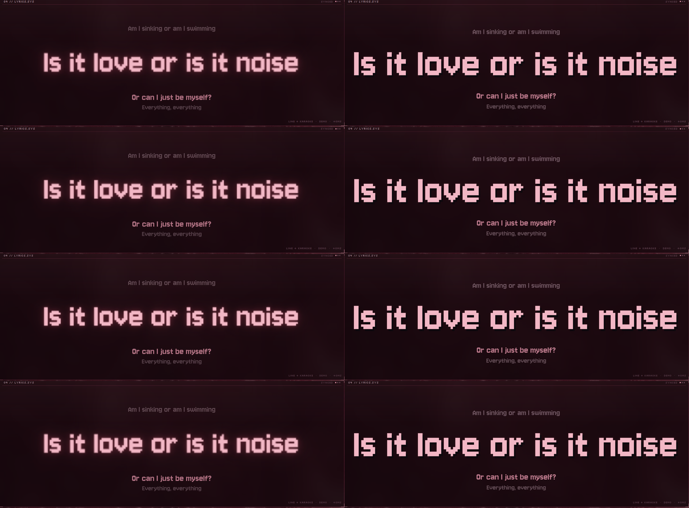
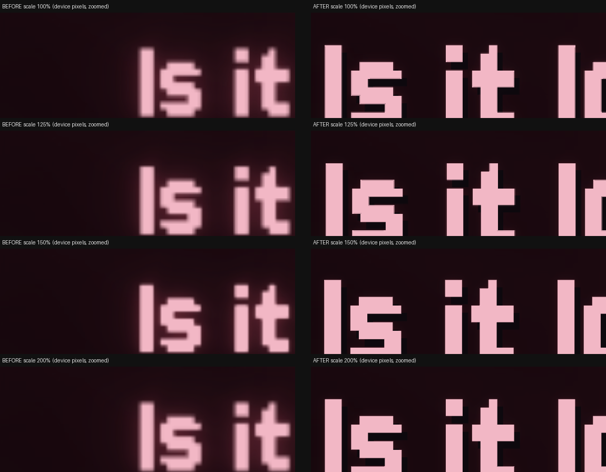

# Design notes

## 1. Reference analysis

The reference is a 22 s TikTok clip (1024×576) of a tiling-compositor desktop. What it shows:

| area | reference | Crimson Desktop |
|---|---|---|
| background | red marbled "fluid" wallpaper | your best crimson wallpaper (auto-ranked), graded toward the palette; procedural marble fallback |
| tiles | translucent, gapped, blurred, thin borders | `Panel`: pre-blurred wallpaper slice + burgundy fill + hairline border + corner brackets + index labels (`04 // LYRICS.SYS`) |
| top-left | music player with album art and playlist | `NowPlaying`: art (crossfade), title in pixel type, artist/album, tick progress bar, transport, mini spectrum |
| top-right | maze-like line pattern | `Circuit`: generative PCB traces, seeded per track, growth speed and brightness driven by bass/energy |
| left strip | column of digits | `DataRain`: hex glyph rain whose speed follows music energy |
| centre | one huge pixel word ("YOU", "BE", "EVERYTHING", "BACK", "MYSELF?") | `LyricsPanel`: word mode (identical idea, with the full line beneath in karaoke colours) or line mode (current line huge, neighbours dimmed) |
| below centre | `pfetch` in a terminal | `SysTerm`: live system info drawn as a terminal (VT323) |
| bottom-centre | circular CAVA | `CircleViz`: mirrored ring spectrum + bass-breathing inner ring |
| right | vertical CAVA bars | `SpectrumBars`: 48 real bars with falling peak caps |
| bottom-right | low-res pink blob | `PixelBlob`: dithered metaballs sized by bass/mid/high |
| — | — | `ClockPanel` (added): pixel clock, date, CPU/GPU/RAM meters |

Palette (from the brief, checked against the frames): bg `#0B080D`, burgundy `#230B17`, crimson `#8D2445`,
rose `#C0485F` (bars), dusty `#D58B9F`, pale `#F2B7C5`, muted `#A88B98`.
Type: **Jersey 10** for the big pixel words (closest open match to the reference lettering), VT323 for
terminal blocks, Silkscreen for tiny labels, Space Mono for numbers, and readable UI fonts (Inter /
Noto Sans, JetBrains Mono) for the rest of the desktop.

Changes from the reference, for readability and daily use:
* Lyrics are the biggest tile, and line mode shows context (previous and next lines).
* Glow, grain and scanlines are subtle and turn off in the low profile.
* Every value shown is real: system stats, spectrum, track data.

### Big lyric typography (`PixelText.qml`)

The lyric, clock and status words use **Jersey 10**, which already has a pixel look. It's drawn as
vector glyphs at the monitor's *physical* resolution, using Qt's curve text renderer on Qt 6.7+ and
distance-field text on older versions. So it stays sharp at 100/125/150/200 % scaling and while it
animates. Contrast comes from a hard one-step drop shadow plus a faint glow behind the text (the glow
is off in the low profile).

Earlier versions drew the text into a texture at 1/2.5 of the size and enlarged it with
nearest-neighbour, with a 40 px blur glow underneath. That gave uneven, fuzzy-edged blocks and a halo
at every scale. The chunky look is still available as `lyrics_style = "retro"` in `[ui]`: each block
is a whole number of device pixels and glyph antialiasing is off, so the blocks stay hard.

Layout: the active line is up to 150 px (scaled to the screen) and fits itself to the tile. Long lines
wrap onto up to three lines and never shrink below 36 px. The previous and next lines sit a fixed
distance from the actual glyphs, not from the text box, so short lines don't leave big gaps.

## 2. Desktop environment decision: stay on KDE Plasma (no Hyprland)

The reference was made on a tiling compositor (Hyprland-style). I evaluated adding one as a second
login session and **recommend against it**:

* The defining features (per-monitor dashboard surfaces below windows, no focus stealing,
  translucent tiles) are all reachable on **KWin** through **wlr-layer-shell**. KDE's own
  `layer-shell-qt` implements it, and the dashboard uses it directly.
* The tile "blur" is done in the dashboard itself, from a pre-blurred wallpaper slice. It costs
  nothing at runtime and doesn't depend on the compositor.
* A second compositor means duplicating everything: panels, notifications, lock screen, portals,
  polkit agent, screen sharing, gaming quirks. That's a maintenance cost for no visual gain here.
* On Nobara/Fedora, Hyprland availability and versions change between releases, and some setups
  rely on COPR. Your rules require approval for third-party repositories anyway.

If you still want a tiling session later, it can be added as a separate SDDM session without
touching Plasma. The dashboard already speaks layer-shell, so it would run there unchanged. That
would need your explicit go-ahead.

## 3. Architecture

**crimson-core** (asyncio, one process, systemd user service) owns:
* `MprisWatcher` (jeepney): NameOwnerChanged, PropertiesChanged and Seeked signals. Position is
  modelled as an anchor `(pos, monotonic, rate)` with light periodic correction. It tolerates
  Spotify's occasional "position = 0" glitch, recovers from bus loss, and follows Spotify when it
  restarts.
* `LyricsService`: local `.lrc` → cache → LRCLIB `/api/get` (exact signature) → `/api/search`
  (ranked by title/artist similarity, duration within tolerance, synced preferred). Network
  errors are not cached; "not found" is cached for 24 h.
* `Spectrum`: one CAVA process, raw 8-bit binary on stdout. It runs only while a client wants
  the spectrum, music is playing and the dashboard is visible, and stops 2.5 s after a pause.
* `SysInfo`: `/proc` + `/sys` (amdgpu `gpu_busy_percent`, `nvidia-smi` throttled to every 4 s),
  plus GameMode `ClientCount` over D-Bus.
* UI state (visible / layout / performance / profile), persisted in `~/.local/state/crimson-desktop/ui.json`.
* Per-track offsets in `~/.local/state/crimson-desktop/offsets.json`.

Protocol: newline-delimited JSON on `$XDG_RUNTIME_DIR/crimson-desktop/core.sock` (mode 0600).
Server → client topics: `player`, `lyrics`, `art`, `ui`, `toast`, plus opt-in `spec` and `sys`.
Client → server: `sub`, `play_pause`, `next`, `prev`, `seek`, `seek_rel`, `offset`, `reload_lyrics`,
`raise`, `ui`, `status`. Clients extrapolate position themselves, so nothing streams at 60 Hz
except the spectrum (~45 small frames/s, and only while visible and playing).

**crimson-dashboard** (PySide6 + QML):
* Host selection: layer-shell when the plugin and QML module exist (`org.kde.layershell`). If
  loading fails at runtime, it re-executes itself in window mode.
* Screen selection: config connector name, or else the right-most screen. On hot-plug it exits
  with code 75 and systemd restarts it on the correct screen.
* Input region (`QWindow.setMask`): only controls, the progress bar, art and lyrics accept input.
  Clicks elsewhere reach the desktop.
* Hidden means the window is unmapped: zero rendering. Paused means the decorative timers stop.
* Performance levels set the frame cap (15 / 30 / 60 fps), glow, grain and decor animations.
  Lyrics timing always runs at ≥25 Hz.

**crimson-lyrics** (Kitty TUI): connects to the same socket. It starts the service if needed, or
falls back to an embedded core. Differential redraws use synchronized-update escapes; it re-renders
only when the visible line, word or second changes.

## 4. Wayland / KDE limitations (and what was done instead)

| wish | reality on KDE Wayland | solution |
|---|---|---|
| widget embedded *behind desktop icons* like a wallpaper | not exposed to clients | layer-shell **bottom** layer: above the desktop, below all windows |
| `xwinwrap`-style tricks | X11 only | not used |
| client picks window position | Wayland clients can't position toplevels | layer-shell anchors; KWin rule (forced position/size) in fallback mode |
| compositor blur behind the dashboard | needs KWin blur protocol (not reachable from PySide) | pre-blurred wallpaper slices (cheaper and exact) |
| Kitty blur | requested by Kitty from KWin (`background_blur`) | enabled; needs KWin's Blur effect (apply-theme turns it on) |
| global shortcuts from scripts | KGlobalAccel reads `kglobalshortcutsrc` at login | written by apply-theme, active after re-login |
| SDDM login theme | needs root and changes the display manager | **not done** (you asked to approve DM changes); can be added on request |

## 5. Performance budget

* **Core:** idle wake-ups every ~1.5 s while playing (position check) plus a 2–6 s stats loop.
  It's an asyncio process using a few MB.
* **CAVA:** one process at 30/45/60 fps by profile, only while playing and visible.
* **Dashboard:** decorative canvases are throttled (circuit draws incrementally and never clears;
  rain and blob run at ≤30 fps in balanced). Bars and ring are scene-graph rectangles (GPU).
  Everything stops when hidden or paused. With GameMode active it switches to low automatically.
* Both services run with `Nice=5` and `CPUWeight=40`.
