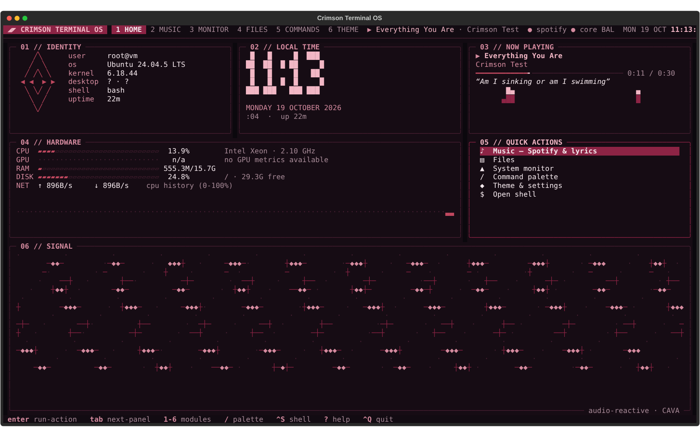
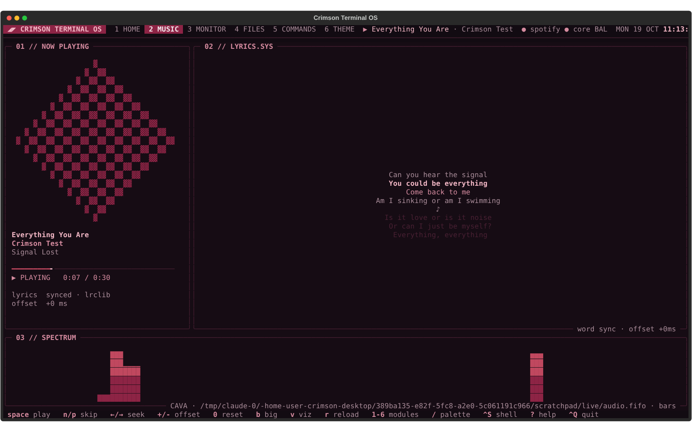
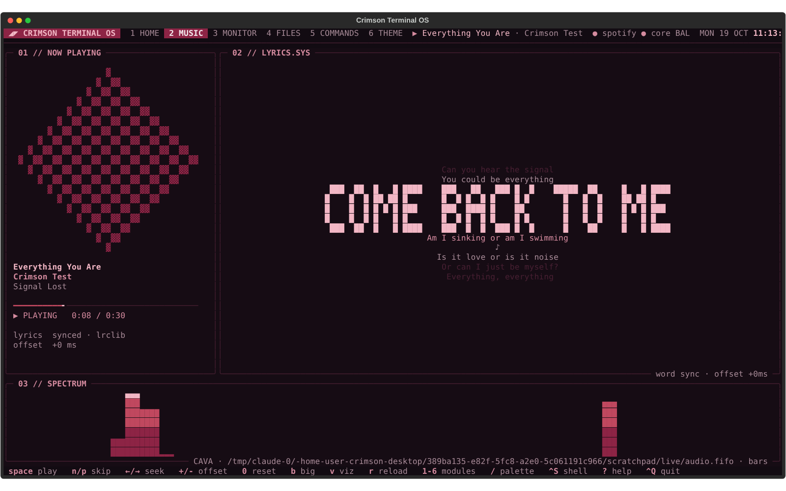
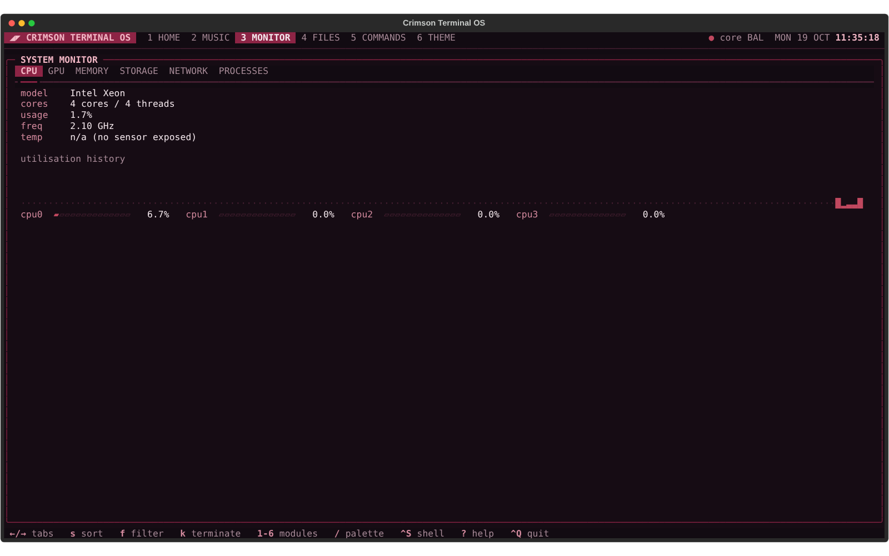
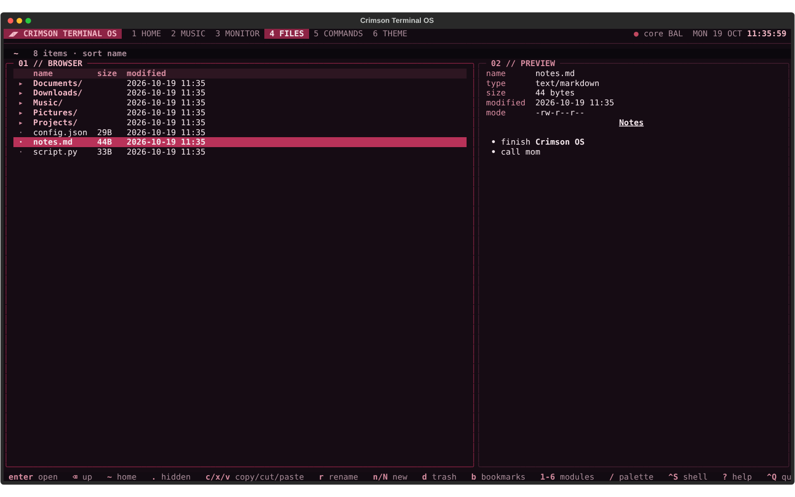
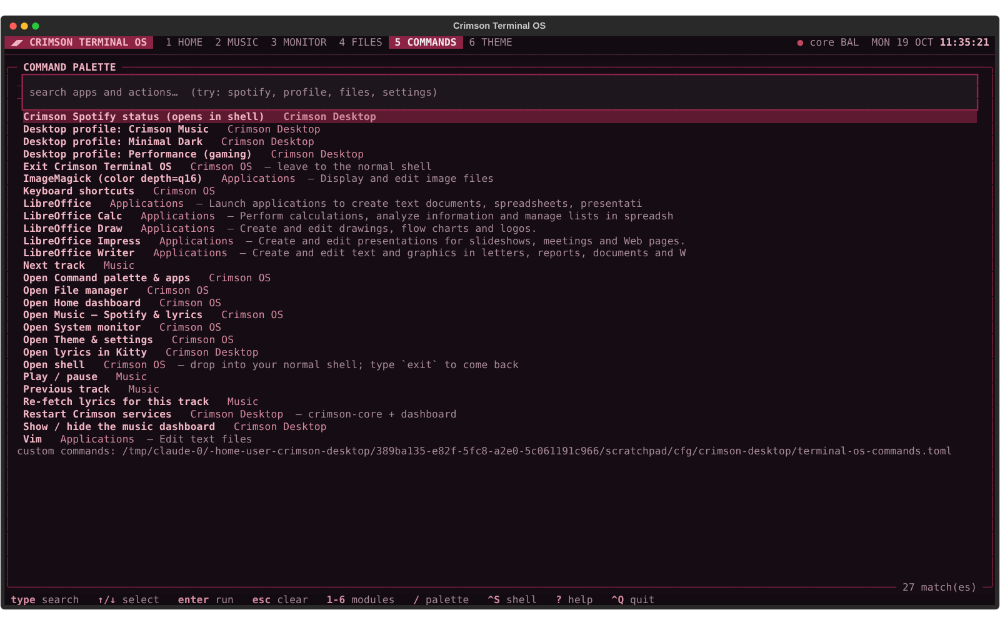
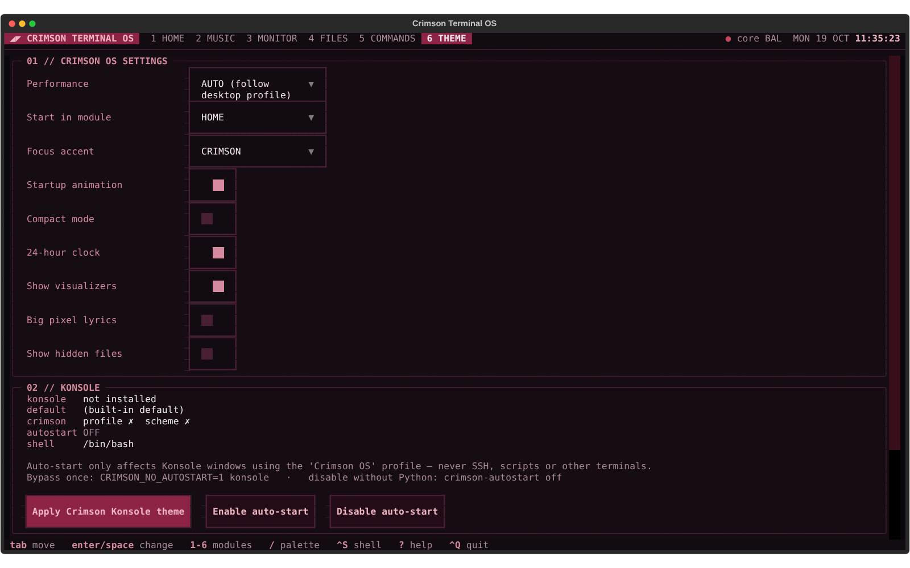

# Crimson Terminal OS

A full-screen command centre that runs **inside Konsole**: a dashboard, Spotify with synced
lyrics and a real audio visualizer, a system monitor, a file manager, an app launcher and
a settings screen. It all uses the Crimson palette. Type `crimson` to open it.

You can also have it open by itself whenever you open Konsole. Quitting it (`Ctrl+Q`) always
drops you into your normal shell prompt.

It is part of Crimson Desktop and lives in `terminal-os/`. The music features reuse the
same `crimson-core` service the desktop dashboard uses: the same lyrics, the same lyric
offsets and the same CAVA feed.



| | |
|---|---|
|  |  |
|  |  |
|  |  |

*The screenshots come from automated test runs in a container: a fake Spotify, a mock
lyrics server and a test tone feed CAVA. That is why the album art is a placeholder and
the host says `root@vm`.*

---

## Install (beginner steps)

You need the Crimson Desktop folder you already cloned (for example `~/Projects/crimson-desktop`).
Open **Konsole** and run these commands one line at a time.

```bash
# 1. go to the project folder
cd ~/Projects/crimson-desktop

# 2. get the newest version
git pull

# 3. install Crimson Terminal OS (no sudo needed; it asks before changing anything in Konsole)
bash terminal-os/scripts/install.sh
```

The installer:

1. checks that Python 3.10 or newer is installed;
2. creates a private Python environment in `terminal-os/.venv` and installs
   `textual`, `rich`, `psutil` and `pillow` into it. Nothing is installed system-wide, and
   it never runs `sudo`;
3. puts three small commands in `~/.local/bin`: `crimson`, `crimson-konsole` and
   `crimson-autostart`. If some other program already owns the name `crimson`, it installs
   ours as `crimson-os` and tells you;
4. asks before adding the Crimson Konsole colour scheme and two profiles. Your existing
   profiles are never overwritten;
5. asks whether Crimson OS should open by itself in new Konsole windows;
6. runs `crimson --doctor` and prints the results.

Then **close every Konsole window and open a new one**. Konsole only reads its default
profile when it starts.

> If the installer says `~/.local/bin is not on your PATH`, log out and back in once.
> Fedora and Nobara add that folder automatically after it exists.

---

## Everyday use

| Command | What it does |
|---|---|
| `crimson` | open Crimson Terminal OS |
| `crimson --help` | list the options |
| `crimson --version` | show the version |
| `crimson --doctor` | check Python packages, the terminal, Konsole, auto-start, crimson-core and GPU metrics |
| `crimson --no-animation` | skip the one-second startup animation |
| `crimson --safe-mode` | don't connect to or start crimson-core (no music features; useful if the music service misbehaves) |
| `crimson --module music` | start in a given module (`home`, `music`, `monitor`, `files`, `commands` or `theme`) |

### Keys

| Key | Action |
|---|---|
| `1` … `6` | Home · Music · Monitor · Files · Commands · Theme |
| `Alt+1…6` or `F1…F6` | the same, and these also work while you are typing in a search box |
| `/` | command palette (fuzzy search through everything) |
| `?` | help overlay with every key |
| `Tab` / `Shift+Tab` | move between panels |
| `Esc` | close a dialog / clear a search |
| `Ctrl+S` | open your shell inside Crimson OS; type `exit` to come back |
| `Ctrl+Q` (or `Ctrl+C`) | leave Crimson OS and go to your normal shell |

Konsole's own shortcuts (`Ctrl+Shift+T` new tab, `Ctrl+Shift+C/V` copy/paste and so on)
are left alone. Crimson OS binds no `Ctrl+Shift` keys.

### The modules

**1 · HOME**: who and where you are (user, OS, kernel, desktop, shell, uptime), a large
clock, what's playing, live CPU/GPU/RAM/disk/network meters with a CPU history graph, quick
actions, and a decorative "signal" panel. That panel moves with the real audio level and
reads `idle (no audio)` when nothing is playing.
The layout rearranges itself into 3, 2 or 1 columns depending on the window width.

**2 · MUSIC**: works through `crimson-core`. Start it with `crimsonctl start` if it isn't
running; Crimson OS also tries to start it once by itself.

* `space` play/pause · `n`/`p` next/previous · `←`/`→` seek 5 s
* `+`/`-` move the lyrics 100 ms earlier/later · `0` reset. Offsets are saved per track and
  shared with the desktop dashboard.
* `b` big pixel lyrics (with word timing when the source has it) · `v` visualizer:
  bars → mirrored → off · `r` re-fetch lyrics.
* The visualizer is the real CAVA spectrum from crimson-core. Its subtitle says whether CAVA
  is listening to **all system audio** or **Spotify only** (`audio_source` in
  `~/.config/crimson-desktop/config.toml`). With no audio it stays flat and says
  "waiting for audio". It never shows made-up bars.
* Album art is drawn with coloured half-block characters, which works in Konsole. Kitty
  image graphics are not assumed. If Pillow is missing you get a Crimson pattern instead.
* Clear status screens when something is missing: OFFLINE (no crimson-core), NO SIGNAL
  (Spotify closed), SEARCHING, INSTRUMENTAL, UNREACHABLE (with the network error and retry
  countdown), unsynced lyrics shown without highlighting, and NO LYRICS.

**3 · MONITOR**: tabs for CPU (per-core), GPU, MEMORY, STORAGE, NETWORK (Wi-Fi and
Ethernet) and PROCESSES.

* GPU: AMD reads amdgpu sysfs (utilisation, VRAM, temperature, power, clock). NVIDIA
  uses `nvidia-smi` if it is installed. Intel shows the clock only. Values a driver doesn't
  expose are shown as `n/a`, never guessed.
* Processes: `f` filter, `s` sort (CPU/RAM/name/PID), `k` terminate. Terminate only works on
  your own processes and refuses critical ones (systemd, kwin, plasmashell, pipewire, sddm,
  dbus, Crimson OS itself…). It always asks first, with **Cancel** selected, and then sends
  a polite SIGTERM.
* Only the visible tab is refreshed, about once a second.

**4 · FILES**: `enter` open · `backspace` up · `~` home · `.` hidden files · `s` sort ·
`f` filter · `b` bookmarks (`B` adds the current folder) · `c`/`x` then `v` copy/cut and paste ·
`r` rename · `n`/`N` new folder/file · `d` move to Trash · `o` open with the default app (KDE's
`kde-open`, else `xdg-open`) · `O` open the current folder in your file manager (Dolphin).

* Nothing is ever overwritten: copy, move, rename and new refuse if the name exists.
* `d` moves the item to the normal desktop Trash, so you can restore it from Dolphin. It
  asks first, with **Cancel** selected.
* Previews never run anything. Text is limited to 64 KB, and terminal escape and control
  sequences are removed before display, so a malicious file can't mess with your terminal.
  Code is syntax-highlighted, Markdown is rendered, JSON is pretty-printed, images show
  their size and binaries show their type.

**5 · COMMANDS**: one fuzzy search over:

* Crimson OS actions and music controls;
* Crimson Desktop actions: the profiles, dashboard toggle and "restart services" (asks
  first);
* every installed app, read from its `.desktop` file. Hidden apps, apps for other desktops
  and apps that aren't installed are skipped. Apps are started with `gio launch` or
  `kioclient exec`, or with their parsed `Exec=` line, **never through a shell**;
* your own commands from `~/.config/crimson-desktop/terminal-os-commands.toml`:

```toml
[[command]]
title = "Projects in Dolphin"
argv = ["dolphin", "~/Projects"]   # an argument list — no shell, so no pipes/;/&&
category = "My commands"
confirm = false                     # true = ask before running
```

Entries starting with `sudo`, `pkexec`, `doas`, `su` or `run0` are rejected. Privileged
things belong in a real shell (`Ctrl+S`), where you can see what you are typing.

**6 · THEME**: settings, saved immediately to `~/.config/crimson-desktop/terminal-os.toml`.
Invalid values fall back to defaults with a warning; they never crash the app.

| Setting | Values |
|---|---|
| Performance (animation level + refresh rate) | `auto` (follows Crimson Desktop: the Performance profile, GameMode or an overloaded PC switch it to low), `low` (2 fps animations, no splash), `balanced` (10 fps), `high` (30 fps) |
| Start in module | home, music, monitor, files, commands, theme |
| Focus accent | crimson, rose, dusty |
| Toggles | startup animation, compact mode (denser: no panel padding, no decorative panel), 24-hour clock, visualizers, big pixel lyrics (music layout), hidden files |

The KONSOLE panel shows the current Konsole state. Its buttons apply the theme and turn
auto-start on or off; they run the same scripts described below. The DESKTOP PROFILE
panel switches the whole Crimson Desktop between **Crimson Music**, **Minimal Dark** and
**Performance**.

---

## Auto-start in Konsole

### How it works

Nothing is added to `.bashrc`, `.zshrc` or any other shell file. Instead:

* `~/.local/share/konsole/Crimson OS.profile` is a Konsole profile whose *command* is
  `~/.local/bin/crimson-konsole`;
* `crimson-autostart on` makes that profile Konsole's **default profile**. It records your
  previous default first and backs up `~/.config/konsolerc`.

Because only Konsole knows about Konsole profiles, all of these are unaffected:

| Situation | Result |
|---|---|
| a new Konsole window or tab | Crimson OS opens; `Ctrl+Q` leaves you in your shell |
| SSH into this PC, or SSH from Konsole to elsewhere | plain shell (not a Konsole profile, plus the wrapper checks `SSH_CONNECTION`) |
| scripts, cron, `bash -c …`, systemd services | untouched (they never start a Konsole profile; the wrapper also needs a real terminal) |
| VS Code / JetBrains / other IDE terminals | untouched (they don't use Konsole profiles) |
| Kitty, Alacritty, GNOME Terminal, etc. | untouched |
| the terminal panel inside Dolphin, Kate or KDevelop | plain shell (they use Konsole's default profile, so the wrapper checks that its parent process is Konsole itself) |
| `konsole -e some-command` | runs that command; the profile command is replaced |
| `TERM=dumb` | plain shell |

### Turning it on and off

```bash
crimson-autostart on       # turn on
crimson-autostart off      # turn off — your previous default profile comes back
crimson-autostart status   # see what's configured
```

`crimson-autostart` is plain `sh` + `awk`, so **it works even if Python, the venv or the
project folder is broken or deleted**.

Other ways out:

* **Skip it once:** `CRIMSON_NO_AUTOSTART=1 konsole`
* **Emergency off switch that needs no script at all:**
  `touch ~/.config/crimson-desktop/terminal-os.autostart-disabled`
* **Through Konsole's own menus:** *Settings ▸ Configure Konsole ▸ Profiles*, select your
  old profile, then *Set as Default*.
* **Pick a profile for one tab:** *File ▸ New Tab ▸ (profile name)*. The **Crimson** profile
  is the same colours with a plain shell.

### Safety nets in `crimson-konsole`

* **Recursion guard:** Crimson OS runs with `CRIMSON_TOS_ACTIVE=1`, so a Konsole started from
  inside it won't start another copy. The variable is removed before your shell starts.
* **Always a shell afterwards:** whatever happens, the wrapper finishes with
  `exec $SHELL`. If `$SHELL` is broken it falls back to your login shell from the system
  user database, then `/bin/sh`.
* **Launch failure:** if Crimson OS crashes or can't start, for example because of a broken
  venv, you get a one-line explanation and your normal prompt. The error is logged to
  `~/.local/state/crimson-desktop/terminal-os.log`.
* **Crash-loop protection:** after **3 failed launches in a row**, auto-start pauses itself
  by creating the disable flag. `crimson-autostart on` re-arms it once you've fixed the
  problem. A normal quit or `Ctrl+C` doesn't count as a failure.

---

## Scripts

All of these live in `terminal-os/scripts/`, run as your user and never use `sudo`.
`--yes` answers "yes" to their questions, so you can run them unattended.

| Script | Purpose |
|---|---|
| `install.sh [--no-autostart] [--force]` | install everything described above |
| `update.sh` | `git pull --ff-only` (skipped if you have local edits), upgrade the venv packages, refresh the wrapper commands and the Konsole files Crimson installed |
| `konsole-theme.sh apply\|remove\|status [--force]` | install or remove the **Crimson** colour scheme and the **Crimson** / **Crimson OS** profiles; doesn't change the default profile |
| `autostart.sh on\|off\|status` | same as `crimson-autostart` |
| `health.sh` | checks that work without Python, then `crimson --doctor` |
| `restore.sh [BACKUP_DIR\|--list]` | put files back exactly as a backup recorded them (default: newest) |
| `uninstall.sh [--purge]` | turn auto-start off, remove the profiles/scheme (only if you haven't edited them), the commands and the venv; `--purge` also removes settings, bookmarks, custom commands and the log |

### What is never overwritten

The scripts keep a list of the files they wrote, with checksums, in
`~/.local/state/crimson-desktop/terminal-os.installed`.

* If a file such as `Crimson.profile` already exists and Crimson didn't write it, or you
  edited it afterwards, it is **left alone** with a warning. `--force` replaces it, but only
  after a backup.
* `remove` and `uninstall` delete only the files that are still exactly as installed.

### Backups

Every change makes a timestamped backup in
`~/.local/state/crimson-desktop/backups/terminal-os/<date-time>-<what>/`. These live outside
the project folder, so they survive if you delete it. Each backup contains:

* `manifest.tsv`: every path, whether it existed before, and where its copy is;
* `files/`: the copies;
* `README`: the exact command that restores it.

`restore.sh` copies back files that existed and **deletes** files that didn't exist at
backup time. It makes a safety backup of the current state first. Running it twice gives
the same result.

---

## Files it touches

| Path | What | Created by |
|---|---|---|
| `terminal-os/.venv/` | private Python environment | install.sh |
| `~/.local/bin/crimson` (or `crimson-os`) | link to `terminal-os/bin/crimson` | install.sh |
| `~/.local/bin/crimson-konsole`, `crimson-autostart` | copies of the sh wrappers | install.sh / konsole-theme.sh |
| `~/.local/share/konsole/Crimson.colorscheme` | colour scheme | konsole-theme.sh |
| `~/.local/share/konsole/Crimson.profile` | plain shell, Crimson colours | konsole-theme.sh |
| `~/.local/share/konsole/Crimson OS.profile` | opens Crimson OS | konsole-theme.sh |
| `~/.config/konsolerc` → `[Desktop Entry] DefaultProfile` | **only this one key** | crimson-autostart on/off |
| `~/.config/crimson-desktop/terminal-os.toml` | settings | the app |
| `~/.config/crimson-desktop/terminal-os-bookmarks.json` | file bookmarks | the app |
| `~/.config/crimson-desktop/terminal-os-commands.toml` | your custom commands (you create it) | you |
| `~/.config/crimson-desktop/terminal-os.autostart-disabled` | disable flag | crimson-autostart off / crash-loop guard |
| `~/.local/state/crimson-desktop/terminal-os.*` | log, failure counter, previous default profile, install list | wrapper / scripts |

No system files, no display-manager or boot settings, no Plasma or Wayland settings and no
other terminal emulators are touched.

---

## Troubleshooting

| Symptom | Fix |
|---|---|
| `crimson: command not found` | log out and back in (so `~/.local/bin` is on PATH), or run `~/.local/bin/crimson` |
| Konsole still opens a plain shell after `on` | close **all** Konsole windows (Konsole caches its default profile), then check `crimson-autostart status`; a `disable flag: present` line means it was turned off or paused after crashes |
| "auto-start paused after 3 failed launches" | run `crimson --doctor` and fix what it reports (often `bash terminal-os/scripts/install.sh` again), then `crimson-autostart on` |
| Music says OFFLINE | `crimsonctl start` (or `crimsonctl status` to see why it stopped) |
| Visualizer says "waiting for audio" | play something; check `audio_source` in `config.toml`; `crimsonctl status` shows CAVA errors |
| Boxes or `?` instead of symbols | use a font with box-drawing glyphs (JetBrains Mono, set by the Crimson profile), or run with `CRIMSON_ASCII=1 crimson` |
| Everything looks too slow or too busy | THEME ▸ Performance ▸ `low`, or turn off the startup animation |
| Something went wrong | `bash terminal-os/scripts/health.sh`, then look at `~/.local/state/crimson-desktop/terminal-os.log` |

---

## Developers

```bash
# all Crimson Terminal OS tests (unit, UI, Konsole integration, failure and restore cases)
terminal-os/.venv/bin/python -m unittest discover -s terminal-os/tests
```

* `tests/test_services.py`: settings validation, file operations (no-overwrite, Trash,
  safe previews), command search and custom-command validation, metrics formatting, the
  terminate safety rules, and the drawing helpers.
* `tests/test_ui.py`: the real app driven headlessly. It covers module switching (including
  while typing), help, the palette, quitting, the quit confirmation, every module at 60×20 up
  to 220×60, the offline messages, creating and trashing a folder through the UI with its
  confirmation, terminating a process (cancel, then confirm), and settings persistence.
* `tests/test_shell.py`: the Konsole wrapper inside a real pseudo-terminal, with every
  bypass and safety path; `crimson-autostart` byte-for-byte konsolerc restore and running
  without Python; the theme/restore/uninstall scripts; and one end-to-end run: wrapper,
  real TUI, `Ctrl+S` subshell, `Ctrl+Q`, normal shell.

All Python tests run in a throw-away `$HOME`, so they never touch your real configuration.

Code layout: `crimson_tos/services/` holds the logic, with no UI code.
`crimson_tos/screens/` holds one file per module. `crimson_tos/widgets/` holds the drawing
helpers and the header/status bar. `crimson_tos/styles/crimson.tcss` is the stylesheet.
`bin/` holds the launchers and `scripts/` the shell tooling.
